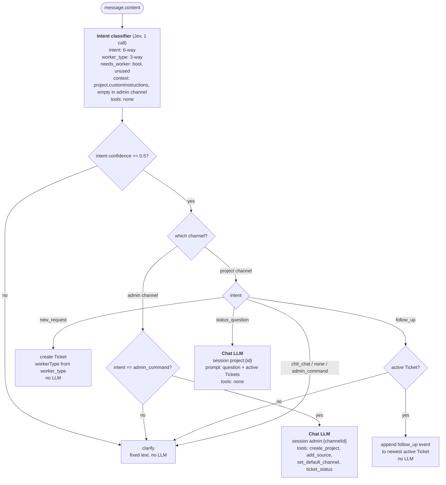

# Decision tree: classifier and LLM

Scope: only the two AI calls inside `handleInbound` (`packages/core/src/application/use-cases/handle-inbound.ts`) and what each can do. Channel ingress, replies, and Workers are out of scope.

Two components, two jobs:

- **Intent classifier** (Jev, `packages/agent-runtime/src/intent-classifier.ts`): labels the message. Decides the route. Has no tools and no side effects.
- **Chat LLM** (`AgentRuntime` on Pi Durable, `packages/agent-runtime/src/agent-runtime.ts`): writes text. Called only on two routes. Tools depend on the session type.

## What each component can do

| Component                     | Called when                                                             | Input                        | Tools                                                                                                                                             | Output                                               |
| ----------------------------- | ----------------------------------------------------------------------- | ---------------------------- | ------------------------------------------------------------------------------------------------------------------------------------------------- | ---------------------------------------------------- |
| Intent classifier             | Every non-duplicate message from a known channel (or the admin channel) | `message`, `project_context` | none                                                                                                                                              | `intent` + confidence, `worker_type`, `needs_worker` |
| Chat LLM, `admin:{channelId}` | Admin channel, confident `admin_command`                                | raw message                  | `create_project` (also creates the project's Discord channel unless `createChannel: false`), `add_source`, `set_default_channel`, `ticket_status` | text, relayed as reply                               |
| Chat LLM, `project:{id}`      | `status_question`; also the reply composed when a Ticket completes      | prompt built in code         | none                                                                                                                                              | text, relayed as reply                               |

Admin tools (`packages/agent-runtime/src/admin-tools.ts`):

| Tool                  | Args                              | Effect                               |
| --------------------- | --------------------------------- | ------------------------------------ |
| `create_project`      | `name`, `customInstructions?`     | Create a Project                     |
| `add_source`          | `projectId`, `type`, `externalId` | Link a channel to a Project          |
| `set_default_channel` | `projectId`, `externalId`         | Set where the Project's replies post |
| `ticket_status`       | `ticketId`                        | Read a Ticket's status               |

## Rules worth knowing

- The classifier decides the route; the LLM never routes. Code branches on `intent`, not on LLM output.
- Only two routes call the LLM for a user message: `admin_command` and `status_question`.
- Project sessions have no tools. The status answer is built only from the ticket list put in the prompt, not from Project Memory.
- No LLM session has channel tools. Replies leave through `ChannelGateway`, never through Pi.
- Sessions are durable: one Pi conversation per session key, de-duplicated by `requestId` (the inbound `externalId`), so a re-delivered message is not answered twice.
- `/project-create` (Discord slash command, `POST /commands`) bypasses both AI calls: it runs the admin `create_project` action directly, under the same admin channel and admin list checks.
- `needs_worker` is classified but nothing reads it yet.
- Classifier failure raises `ClassifierError`; chat failure raises `AgentRuntimeError`.
