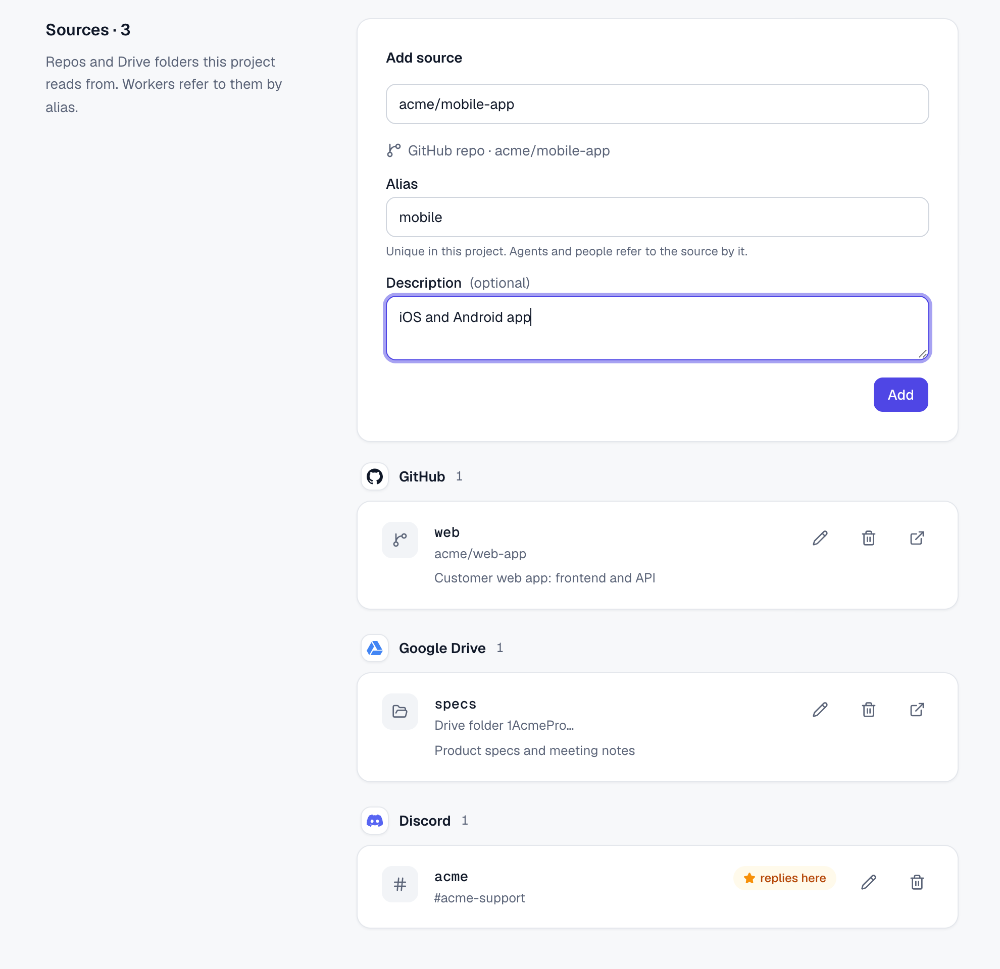
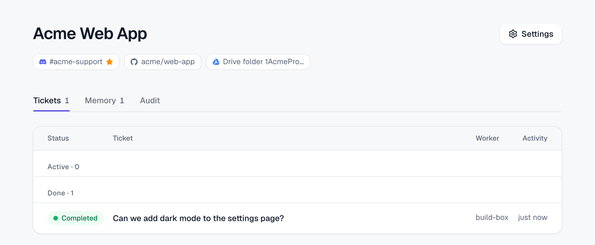
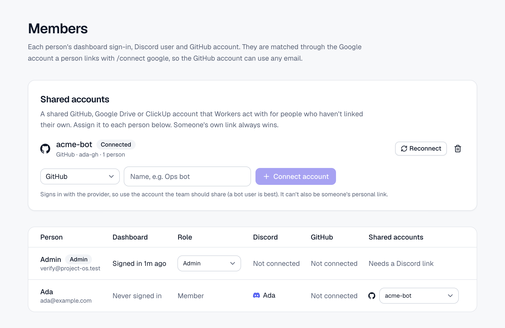

# Connectors

Connectors let project-os reach the places where your project's work lives. A connector is the link to an outside service such as GitHub: once an account is linked through it, project-os can use that service with that account's access. [Inbound channels](../channels/index.md) are different: they are where questions come in.

| Connector             | Used for                        | Can be a project source |
| --------------------- | ------------------------------- | ----------------------- |
| [GitHub](github.md)   | Code, pull requests, and issues | Yes, a repository       |
| [Google Drive](google.md) | Documents in Google Drive       | Yes, a Drive folder     |
| [ClickUp](clickup.md) | Files attached to ClickUp tasks | No                      |

## Add a project source

A **project source** tells project-os which repository or folder a project is about. A connector gives access, and a source says where to look. Each source has an **alias**, unique in its project, that people and agents use to refer to it.

### In the dashboard

You need the [admin role](../guide/setup.md#dashboard-roles).

1. Pick the project in the sidebar, then click **Settings**.
2. Under **Sources**, paste a GitHub repository link (or `owner/repo`) or a Google Drive folder link into **Add source**.
3. Enter an **Alias**. A repository suggests its name.
4. Optional: in **Description**, say what is in it and when to use it.
5. Click **Add**.



Use the icons on a source to edit, remove, or open it. The project page lists its sources under the project name.



### In Discord

Run this in the project's channel or one of its threads:

```text
/source-add link:<link> alias:<name> description:<text>
```

`alias` and `description` are optional for a repository. A Drive folder needs an `alias`. Only you see the reply.

## Your own access

Run `/connect` in Discord to link your own account. When you ask a question, project-os works with your access. Use `/connections` to see what is linked and `/disconnect` to unlink.

If a question needs an account that is not linked, project-os asks you to connect it.

## Shared team accounts

An admin can connect a team account for GitHub, Google Drive, or ClickUp. It is used only for people who never linked their own account.

### Why use one

We suggest creating a dedicated, read-only account for the bot, such as a delegated company email or a separate GitHub user, and connecting it as a shared account. People then get basic access through project-os without setting up an account for each of them.

For example, a company can let its project managers ask about the code while planning features. They get read-only answers from the repositories the bot can see, and need no GitHub account of their own. Someone who needs more, such as having an agent push a branch or open a pull request, [connects their own account](#your-own-access). From then on, project-os uses that account for that connector instead of the shared one.

What the shared account can do is decided by the service, so limit it there:

- **GitHub:** give the bot user the **Read** role, only on the repositories the team should see. Access is also limited by your [GitHub App's permissions](github.md#create-the-app). To let people write with their own accounts, the app needs write permissions. The bot's role still limits the bot. GitHub's Read role is not completely passive: for example, it can open and comment on issues.
- **Google Drive:** share only the needed folders with the delegated account. project-os only reads Drive.
- **ClickUp:** the shared account has the access it has in ClickUp, so invite it only where the team should reach.

Everyone assigned to a shared account can reach everything that account can, so assign it only to people who may see all of it. Actions in the service show up as the bot, and the audit log records who used the shared account.

A person's own link always wins, even after it expires. project-os then asks them to reconnect and does not fall back to the shared account.

### Set one up

The person you assign it to needs no GitHub account for a shared GitHub account. They only need to have run `/connect` in Discord once, so the dashboard knows their Discord account. They do not have to finish linking.

If someone finishes linking Google, including through `/dashboard`, that is their own Google link. It replaces a shared Google account for them.

1. Open **Members** in the dashboard.
2. Under **Shared accounts**, pick the connector, enter a name, and click **Connect account**.
3. Sign in with the account the team should share. A bot user is best. It cannot also be someone's personal link.
4. In the **Shared accounts** column, assign it to each person.


