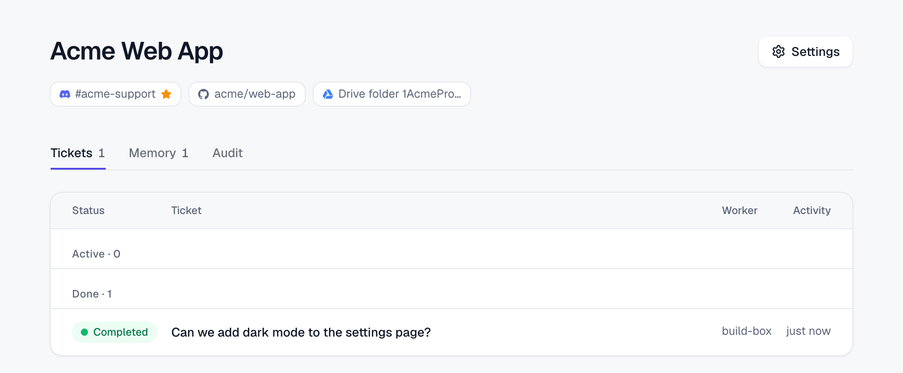

# Quick start

Run the whole loop on your machine: the Coordinator (with the Discord bot), a Watcher that works tickets with local Claude Code, and the dashboard. This uses Docker Compose, which is for development. To run project-os for a team, see [Deploy to Cloudflare](deployment.md).

## 1. Configure

```sh
bun install
cp .env.example .env
```

Fill in `.env`:

- The [Discord bot](../channels/discord.md#set-up) values.
- `OPENROUTER_API_KEY`, and the [models](setup.md#models) if you want others than the defaults.
- `BETTER_AUTH_SECRET`, `COORDINATOR_SERVICE_TOKEN`, `ADMIN_EMAIL` and `ADMIN_PASSWORD`. See [Environment variables](../reference/environment.md).

## 2. Start the Coordinator

```sh
docker compose up --build            # Coordinator :8080 (with the Discord bot), Grafana :3000

# one-time seed (replace with your Discord channel ID)
docker compose exec -e SEED_DISCORD_CHANNEL_ID=<channel-id> coordinator bun run seed
```

SQLite and agent state live in the `coordinator-data` volume (`/data`). To run without Docker:

```sh
bun run --cwd apps/coordinator dev
curl http://localhost:8080/health
```

## 3. Start a worker

The Watcher runs on your computer. It needs the `claude` CLI installed and signed in, or set `WATCHER_AGENT=pi` or `codex` for that CLI, and optionally `WATCHER_MODEL`. Register it first with the code from `/register-worker` (yours), or `/register-worker shared:True` in the admin channel (for everyone):

```sh
set -a; . ./.env; set +a
bun apps/watcher/src/main.bun.ts register <code> --server http://localhost:8080
# Later runs need no code:
bun apps/watcher/src/main.bun.ts
```

By default the Watcher launches `claude -p` with `--allowedTools "mcp__project-os__*"`, so headless sessions can call the Coordinator's MCP tools. `WATCHER_AGENT=pi` runs `pi --print` and `WATCHER_AGENT=codex` runs `codex exec` instead, each with the Coordinator added as an MCP server. For more, see [Local computer](../workers/local.md).

## 4. Open the dashboard

```sh
bun run --cwd apps/web dev
# → http://localhost:5173
```

The dashboard expects the Coordinator on `:8080` (override with `COORDINATOR_URL`). Sign in with `ADMIN_EMAIL` and `ADMIN_PASSWORD`, or with Google ([Dashboard sign-in](setup.md#dashboard-sign-in)). You should see projects, live tickets, Project Memory, and worker health refreshing every few seconds. `bun run --cwd apps/web build` exports the dashboard as a static site.



Next, [add a project source](../connectors/index.md#add-a-project-source) so project-os knows which repository or folder the project is about.

If something does not work, see [Troubleshooting](../reference/troubleshooting.md).
