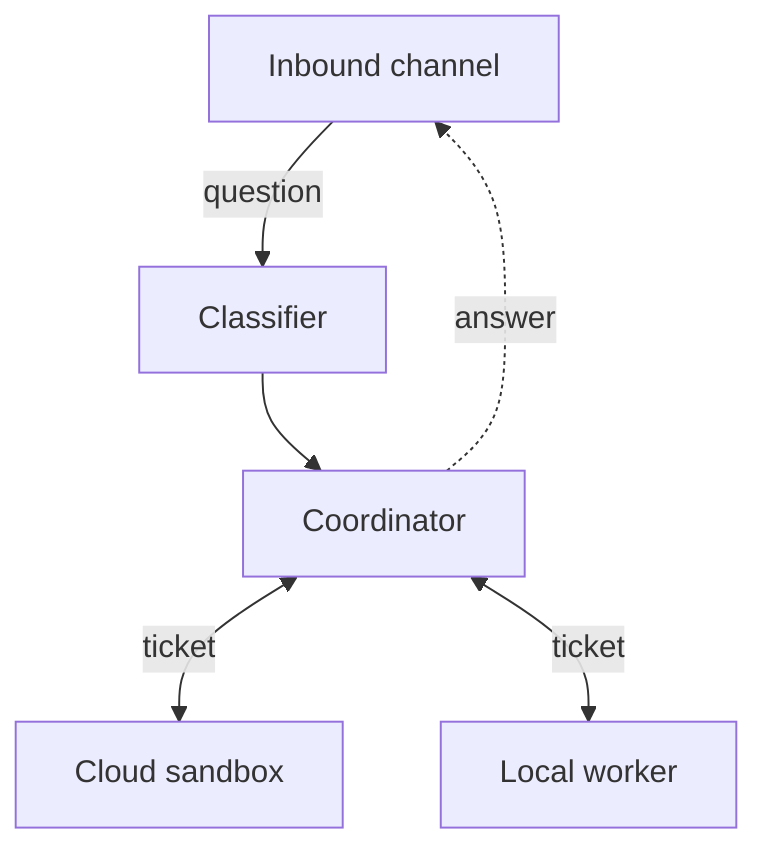

# How it works

Your team's project knowledge is spread across chat, documents, code, and people's heads, so the same questions keep interrupting engineers. project-os lets anyone ask in the project's channel and get a grounded answer back. For the story behind it, see [Why project-os](why.md). For the design in depth, see the [technical architecture](reference/architecture.md).

| Part                              | What it does                                                           |
| --------------------------------- | ---------------------------------------------------------------------- |
| **Inbound channel**               | Where your team already asks, such as Discord.                         |
| **Classifier**                    | Works out what each message is asking for.                             |
| **Coordinator**                   | Keeps the project's context, tracks each ticket, and sends the answer. |
| **Cloud sandbox or local worker** | Does the research, in the cloud or on a developer's own machine.       |

## What a question goes through

1. Someone asks a question in the project's channel.
2. The classifier works out what they need. If it is not sure, project-os asks them to clarify. A question about the progress of an existing ticket can be answered right away.
3. For new work, the Coordinator opens a ticket with the project's context.
4. A cloud sandbox or a local worker takes the ticket, does the research, and writes back what it found.
5. The Coordinator posts the answer in the channel.

What the worker learns can be saved to the project's memory, so the next related question starts with more context.
