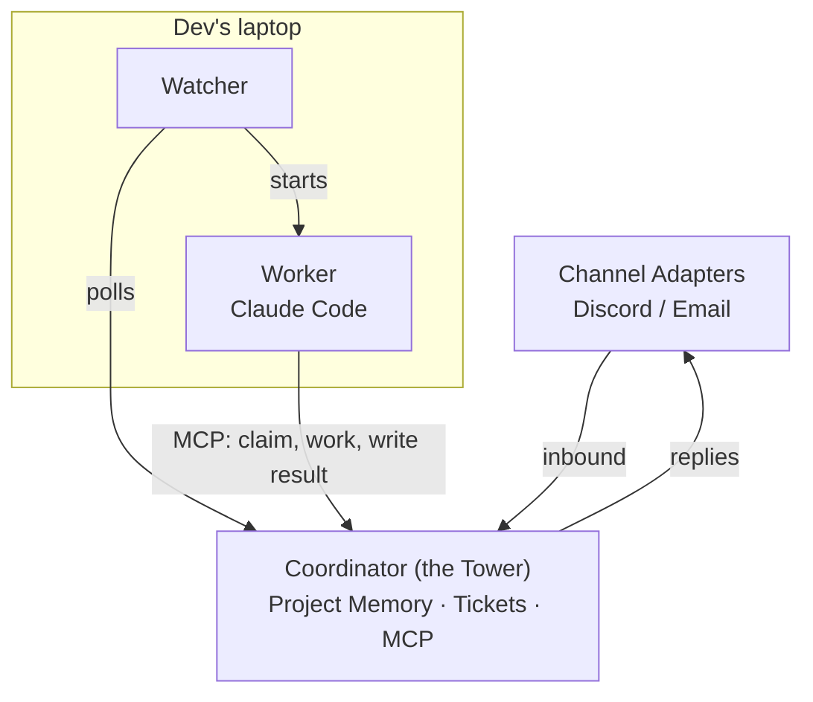

# How it works

project-os works like a control tower. Channels bring questions in, the Coordinator turns them into Tickets, Workers clear the Tickets, and only the Coordinator talks back. For the story behind it, see [Why project-os](why.md). For every component in depth, see the [technical architecture](reference/architecture.md).

| Role                | Real-world analogy      | Responsibility                                               |
| ------------------- | ----------------------- | ------------------------------------------------------------ |
| **Coordinator**     | Control Tower           | Owns context, tickets, memory, outbound messages             |
| **Channel Adapter** | Radar / radio           | Thin translator. No business logic.                          |
| **Ticket**          | Flight plan / clearance | Single source of truth for status + results                  |
| **Worker**          | Pilot / aircraft        | Claims one ticket, works it via MCP, never talks to channels |
| **Watcher**         | Ground crew             | Polls for assigned tickets and launches local Claude Code    |
| **Project Memory**  | Flight database         | Durable facts the whole team (and future workers) can read   |

Workers speak **MCP only**. Everything they can do is a tool call: read/append ticket, read/write Project Memory.

## What a question goes through

1. A Channel Adapter turns the message into a standard inbound event.
2. The Coordinator loads the Project and its Memory, opens a Ticket, and marks it `assigned`.
3. A Watcher on a developer's machine (or a cloud sandbox) sees the ticket and starts a Worker session.
4. The Worker claims the ticket, researches with Project Memory and the project's sources, and writes its findings back.
5. The Coordinator posts a cited answer in the channel.

The next related question starts with the updated Project Memory.
