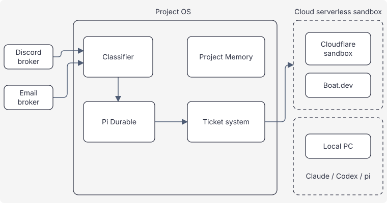

# How it works

Your team's project knowledge is spread across chat, documents, code, and people's heads, so the same questions keep interrupting engineers. project-os lets anyone ask in the project's channel and get a grounded answer back. For the story behind it, see [Why project-os](why.md). For the design in depth, see the [technical architecture](reference/architecture.md).

| Part              | What it does                                                                                                |
| ----------------- | ----------------------------------------------------------------------------------------------------------- |
| **Brokers**       | Bring in messages. Discord is where your team asks. Email is read only, to add facts to Project Memory.     |
| **Classifier**    | Works out what each message is about.                                                                       |
| **Pi Durable**    | Runs the Project OS agent.                                                                                  |
| **Project Memory** | Keeps the facts and decisions of each project.                                                             |
| **Ticket system** | Tracks each piece of work from question to answer.                                                          |
| **Workers**       | Do the research, in a cloud serverless sandbox or on a local PC with Claude, Codex, or pi.                  |

## What a question goes through

1. Someone asks a question in the project's Discord channel.
2. The classifier works out what they need. If it is not sure, project-os asks them to clarify. A question about the progress of an existing ticket can be answered right away.
3. For new work, Project OS opens a ticket with the project's context.
4. A cloud sandbox or a local PC takes the ticket, does the research, and writes back what it found.
5. Project OS posts the answer in the channel.

What the worker learns can be saved to the project's memory, so the next related question starts with more context.
