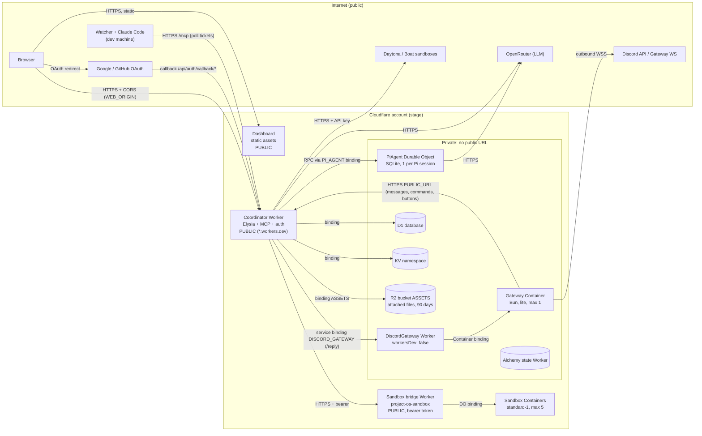

# Cloudflare infrastructure

What `alchemy.run.ts` deploys, what is reachable from the internet, and which links stay on Cloudflare's private network. Setup steps are in [deployment.md](deployment.md).

## Diagram

## Exposed

| Surface | URL | Auth | Note |
| --- | --- | --- | --- |
| Dashboard | `dashboardUrl` | none | Static files only, no Worker code. |
| Coordinator Worker | `coordinatorUrl` (`PUBLIC_URL`) | **none** | HTTP API, `/mcp`, `/connect/:token`, `/api/auth/*`. Public by default on `workers.dev`. CORS allows only `WEB_ORIGIN`, which is a browser rule, not access control. Put a shared secret or Cloudflare Access in front before real data. |
| Sandbox bridge Worker | `project-os-sandbox` URL (`CLOUDFLARE_SANDBOX_URL`) | `BRIDGE_TOKEN` bearer | Deployed with wrangler, outside the Alchemy stack. Public URL, gated by the token only. |

## Private (Cloudflare internal)

No public URL; reachable only through a binding from another Worker in the same account.

| Link | Mechanism | Why private |
| --- | --- | --- |
| Coordinator → D1 | `DB` binding | Data never leaves the account. |
| Coordinator → KV | `KV` binding | Same. |
| Coordinator → R2 | `ASSETS` binding | The bucket has no public URL or custom domain. Workers download through the Coordinator's signed `/assets/...` links, and the Coordinator reads the bucket by binding. |
| Coordinator → Pi sessions | `PI_AGENT` Durable Object RPC | DO has no route of its own. |
| Coordinator → DiscordGateway | `DISCORD_GATEWAY` **service binding** | The reply endpoint can post as the bot and has no auth, so `workersDev: false` and the binding is the only way in. |
| DiscordGateway Worker → Container | Container / DO binding | Container is not addressable from outside. |
| Sandbox bridge → Sandbox containers | `Sandbox` DO binding | Sandboxes are only reachable through the bridge Worker. |
| Alchemy state | `Cloudflare.state()` Worker | Shared between CI and laptops; deploy tooling only. |

`DISCORD_BOT_TOKEN` is bound to the gateway only, never the Coordinator.

## Not private (leaves or enters over the internet)

- Gateway Container → Coordinator: HTTPS to `PUBLIC_URL`. Goes through the public URL, not a binding, so it carries the Coordinator's no-auth exposure.
- Gateway Container → Discord: outbound WSS. Inbound is never opened.
- Coordinator and Pi → OpenRouter, Daytona, Boat: outbound HTTPS with API keys.
- Coordinator → sandbox bridge: HTTPS over the public URL (the bridge is a separate deploy, so no service binding).
- Watcher → Coordinator `/mcp`: HTTPS from the dev machine.
- Browser → Coordinator: direct, no proxy (the `/api` proxy was dropped).

## Gaps worth closing

1. Coordinator has no auth. Everything in the "Exposed" table's Coordinator row is open.
2. The gateway container calls the Coordinator over its public URL. Moving it to a service binding the other way (gateway → Coordinator) would keep that hop private, but needs the Coordinator in the gateway's `env` (circular today: the Coordinator already binds the gateway).
3. Sandbox bridge could be added to the Alchemy stack and reached by service binding instead of a public URL plus token.

## Conditional resources

- `DiscordGateway` + `GatewayImage` container: only if `DISCORD_BOT_TOKEN` and `PUBLIC_URL` are set and `DISCORD_SPLIT_GATEWAY_URL` is not. Joins on the second deploy.
- Sandbox bridge, Daytona, Boat: only if the matching `*_URL` / key vars are set.
- Coordinator health-sweep cron: not yet (`scheduled` handler missing).
